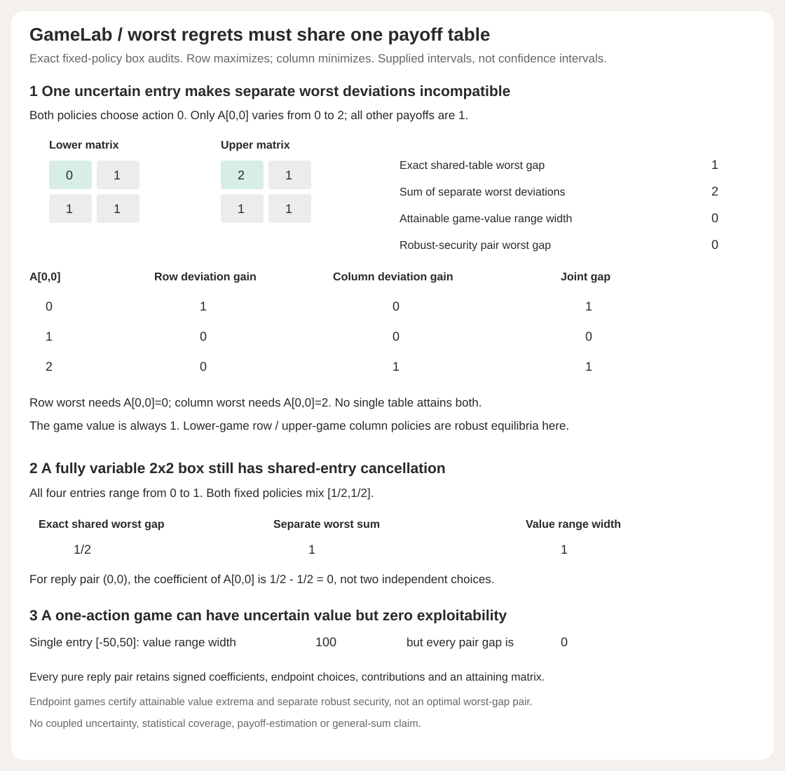

# One payoff table, not separate worst regrets



The interval extension audits **fixed policies** against every matrix in a supplied full Cartesian entrywise box `L <= A <= U`. Each entry may vary independently as a set description; no stochastic independence or probabilistic coverage is assumed. The same matrix must serve both players when measuring the joint deviation gap. Adding separately maximized regrets can give an unattainable number.

```bash
python -m gamelab interval-demo
python -m gamelab intervals examples/intervals-input.json
python examples/render_intervals.py --check
```

```python
from gamelab import interval_audit
r = interval_audit([[0,1],[1,1]], [[2,1],[1,1]], [1,0], [1,0])
print(r["chosen_pair"]["worst_gap"])  # '1'
print(r["chosen_pair"]["sum_separately_maximized_deviations"])  # '2'
print(r["value_range"]["width"])  # '0'
```

## A concrete conflict

Only entry `A[0,0]` varies between zero and two; all other entries equal one. Both supplied policies choose action zero. At entry zero, row deviation gain is one and column gain zero. At entry two, row gain is zero and column gain one. At entry one, both are zero. The exact shared-table worst joint gap is **one**, not the sum **two** of individual maxima. That sum is an upper bound, not an attainable simultaneous outcome.

The game value is one for every allowed table. A robust-security pair from the lower game's row policy and the upper game's column policy has gap zero throughout this box. The fixed chosen pair's nonzero worst gap does not mean the box has no robust equilibrium.

For a full `2x2` box with every entry in `[0,1]`, both fixed policies `[1/2,1/2]` have exact worst gap `1/2`, versus separate worst-regret sum one and value-range width one. For reply pair `(0,0)`, the shared entry `A[0,0]` has coefficient `1/2-1/2=0`. A signed coefficient must be formed before maximizing over its interval. For a `1x1` game with sole entry `[-50,50]`, game-value range width is 100 but exploitability is identically zero. Uncertain payoff value is not the same as uncertain incentive to deviate.

## Exact support witnesses

For row policy `x` and column policy `y`, the gap under A is

```text
g(A) = max_i (Ay)_i - min_j (x^T A)_j
     = max_(i,j) [ (Ay)_i - (x^T A)_j ].
```

There are at most 16 pure reply pairs. For a given `(i,j)`, form every entry's coefficient

```text
C[k,l] = 1[k=i] * y[l] - x[k] * 1[l=j].
```

Its linear objective over the Cartesian box is maximized by selecting `U[k,l]` when C is positive and `L[k,l]` when C is negative. When C is zero, any allowed value attains that component; GameLab deterministically chooses L and labels the choice `free`. With zero-width intervals, a selected upper or lower is the same number. Each candidate retains the entire coefficient matrix, endpoint-choice labels, selected matrix, entry contributions and exact linear maximum.

A maximum over a finite set of reply pairs commutes with a maximum over matrices. Thus the largest candidate maximum is exactly `max_A g(A)`, not an approximation. The report lists all maximizing reply-pair indices, returns one attaining matrix and directly audits it. At that selected matrix the full best-reply gap equals the claimed worst value. Other candidate matrices attain their **own linear reply-pair objective**; they need not make those candidate replies best replies, nor attain the global worst gap. No claim is made that exported matrices list every maximizing matrix or that all individual free coordinates can be varied without considering the other candidate objectives.

Separate row-deviation candidates use coefficients

```text
R_i[k,l] = (1[k=i]-x[k]) * y[l]
```

and separate column-deviation candidates use

```text
Q_j[k,l] = x[k] * (y[l]-1[l=j]).
```

The same support construction gives exact individual worst gains, every maximizing reply index and an attaining matrix for each candidate. Their sum is at least the exact shared-table gap; the difference is reported as `separate_deviation_conservatism`. A second, possibly looser bound is `max_i(Uy)_i-min_j(x^T L)_j`, reported as `separate_security_bound`, with its own slack. The scalar expected payoff range is exactly `[x^T L y, x^T U y]`, attained at the endpoint matrices because probability products are nonnegative.

The joint gap is a sum of the two unilateral deviation gains **under the same matrix**. It is also the sum of both security exploitabilities relative to that matrix's own game value. Individual deviation gain and individual security exploitability need not agree. Interval candidate support reports here use unilateral deviation gains; they do not pretend to maximize a particular player's security exploitability over changing game values.

## Attainable game-value extrema and robust security

The full endpoint games are solved with all minimax bases and certificates retained. Monotonicity gives `v(L)<=v(A)<=v(U)` for every allowed A: every pair's expected payoff is monotone entrywise, and min/max preserve order. These extrema are attainable at the endpoint matrices, so the value range is exact, not merely an enclosure. Continuity of finite-game value along the line between the endpoints also implies that every intermediate value is attained, although GameLab returns endpoint witnesses rather than solving an inverse-value problem.

Let `x_L` be a row equilibrium policy of L, and `y_U` a column equilibrium policy of U. Because these are nonnegative probability vectors,

```text
min_j (x_L^T A)_j >= v(L)
max_i (A y_U)_i   <= v(U).
```

They are separately optimal worst-security policies: L is an attainable adverse matrix for any fixed row policy, and U an attainable adverse matrix for any fixed column policy. The report returns their endpoint pure-action payoffs, exact floor/ceiling and a guaranteed gap upper bound `v(U)-v(L)`. It also runs the full signed support audit on this pair, which can be strictly smaller than that value width.

This construction does **not** solve `min_(x,y) max_A g(A)` and no worst-joint-gap optimality is claimed. A value width of zero is sufficient for a common robust equilibrium under this construction, but a positive width does not rule one out: the one-action control is the simplest counterexample.

## Schemas, limits and verification

The new `intervals` CLI accepts exactly `schema_version:1`, `lower`, `upper`, `row_strategy`, `column_strategy`. Both matrices have the same supported `1..4` by `1..4` shape, every lower entry is at most its upper entry, and strategies are valid exact simplexes of matching length. Existing rational/bit/string/byte/UTF-8/duplicate/unknown-key restrictions apply. `interval-demo` takes no input. Both emit complete JSON and use no external service.

53 tests now pass. Thirteen new behavioral tests include all 16 combinations of zero/one interval widths on a nonconstant `2x2` base, each at nine fixed policy pairs, checked against independent enumeration of every endpoint matrix. They check exact joint and separate maxima and expected-payoff extrema. Additional checks verify every candidate support coefficient, endpoint contribution and attainment, game values and robust security at all corners, zero-width recovery, affine invariance, shared-entry conflict, singleton cancellation, full-box ties, rectangular/4x4 capacity, no input/RNG mutation and complete/invalid CLI paths. Three new figure tests bind all 29 displayed numbers, the complete compressed report, hidden coefficient tampering and exact byte regeneration. The original 37 tests and four complete original CLI outputs stay unchanged. The six-module installed wheel matches all six complete CLI outputs outside checkout. CI includes both new commands, checked-in fixture reproduction and both figure generators.

The endpoint enumeration is a **test oracle**, not the runtime algorithm. Runtime fixed-pair support uses at most `m*n+m+n` candidates, each with `m*n` coefficients, plus the two tiny exhaustive endpoint game solves. Exact rationals can still grow large. No speed, general-sum, coupled-budget/ellipsoid uncertainty, empirical score model, sampling independence, simultaneous statistical coverage or new optimization theorem is claimed.

## Attribution

This is an application of established box support functions and finite minimax facts. The [six base minimax/LP sources](DESIGN.md#attribution) remain applicable. Three additional consulted sources:

- [Li, Ding and Floudas, 2011, robust linear optimization](https://pmc.ncbi.nlm.nih.gov/articles/PMC3175142/), Definition 3.1 and Property 4.1: rectangular interval sets and absolute-value robust counterparts. GameLab uses supplied deterministic intervals, not that paper's application assumptions or numerical results.
- [Gorissen and den Hertog, robust counterparts containing sums of maxima](https://optimization-online.org/wp-content/uploads/2011/11/3229.pdf): separately robustifying terms can introduce conservatism. GameLab explicitly retains the shared matrix before taking maxima; this is an application, not a new conservatism result.
- [Bertsimas, den Hertog and Pauphilet, Probabilistic guarantees in Robust Optimization](https://optimization-online.org/wp-content/uploads/2019/09/7378.pdf), support-function Proposition 1 and Table 3: box support functions. Only the deterministic support identity is used here, not that paper's probabilistic guarantees.
