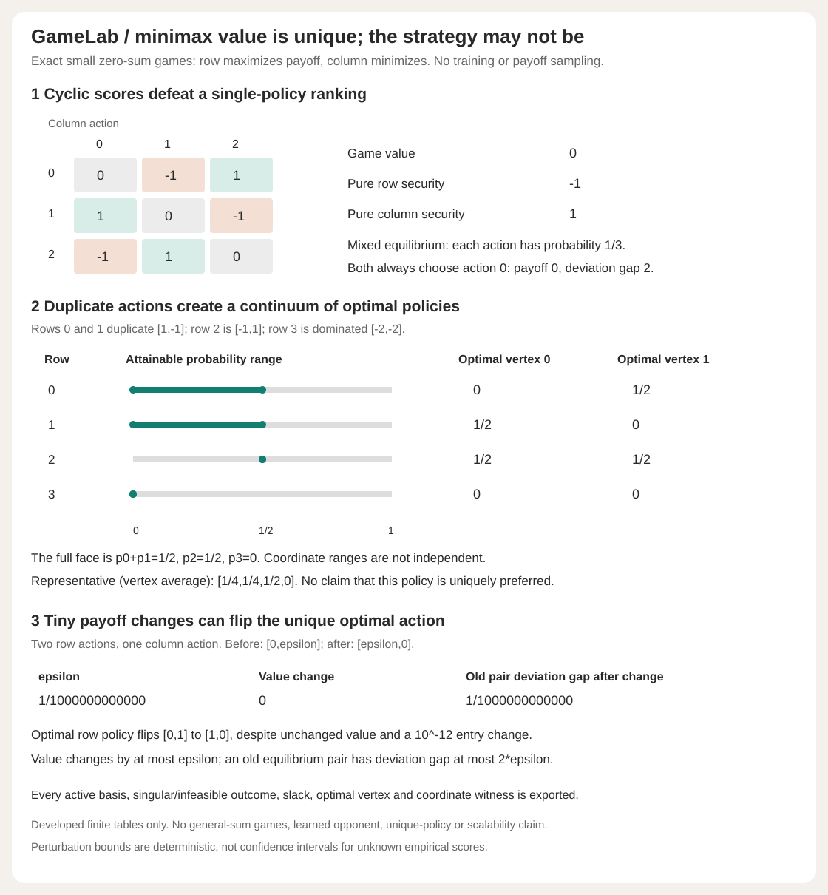

# GameLab

Exact-rational minimax, degeneracy and perturbation certificates for small zero-sum AI score tables.



A score table can be cyclic: one policy defeats a second, loses to a third, and has no meaningful single-policy ranking. Even when a zero-sum game's value is unique, its optimal randomized policy can have an entire continuum of choices. GameLab solves the supplied finite game, shows both players' security witnesses, enumerates all optimal strategy vertices and exposes what a chosen policy pair leaves exploitable.

This is a dependency-free Python 3.10+ numerical-mechanics project. It does not train agents, collect tournament scores, infer a zero-sum interaction from data or claim a new equilibrium algorithm.

## Run

```bash
python -m gamelab demo
python -m gamelab solve examples/solve-input.json
python -m gamelab audit examples/audit-input.json
python -m gamelab perturbation examples/perturbation-input.json
python -m unittest discover -s tests -v
python examples/render_demo.py --check
```

No API key, network call, third-party runtime package or paid service is needed. `pip install .` installs the importable package. All four modes emit complete JSON. Invalid input exits two with empty stdout.

```python
from gamelab import solve, audit, perturbation

r = solve([[1,-1], [1,-1], [-1,1], [-2,-2]])
print(r["value"])                            # '0'
print(r["row"]["representative"])            # ['1/4','1/4','1/2','0']
print(r["row"]["unique_optimal_strategy"])   # False
print(r["row"]["optimal_vertices"][0]["strategy"])
# ['0','1/2','1/2','0']

rps = [[0,-1,1],[1,0,-1],[-1,1,0]]
print(audit(rps, [1,0,0], [1,0,0])["duality_gap"])  # '2'
```

## What is certified

The input `A` is the **row player's payoff**. The row player maximizes `x^T A y`; the column player minimizes it and receives its negative. Randomizations are independent. Rows/columns are ordered action identifiers, not model names inferred from files.

GameLab enumerates basic feasible solutions of each security LP. The row problem is `max v` with `sum x=1`, `x>=0`, `x^T A[:,j]>=v` for every column. The column problem is solved as the row problem on `-A^T`, so its returned internal value is `-v`. The report deliberately names that side `column_negative_game` to keep the sign visible.

For every possible active basis, the report retains selected constraint labels, exact rank/determinant/pivot columns, a solution if nonsingular, all inequality slacks, violated constraints and the singular/infeasible/feasible result. Duplicate feasible vertices merge their distinct bases rather than appearing as different strategies. Both security values agree exactly. A representative equilibrium exports all pure-action payoffs, best-reply ties, probability sums, primal/dual slacks and zero complementary-slackness products.

The **full optimal strategy set** is the convex hull of all exported optimal vertices. A single optimal vertex means the strategy is unique; multiple vertices mean a continuum. The representative is the equal average of distinct optimal vertices, a transparent deterministic choice, not a uniquely preferred or maximum-entropy policy. Coordinate minima/maxima each include attaining vertex indices. Their separate ranges are not an independently selectable box.

## Developed controls

- Rock-paper-scissors has value zero and unique strategy `[1/3,1/3,1/3]` for both players. Best pure row security is `-1`, best pure column security is `1`. If both always choose action zero, payoff is zero but each player can gain one by deviating, giving gap two. A plausible-looking average payoff is not an equilibrium certificate.
- The rectangular duplicate-action table `[[1,-1],[1,-1],[-1,1],[-2,-2]]` has row optimal vertices `[0,1/2,1/2,0]` and `[1/2,0,1/2,0]`. Its full face is `p0+p1=1/2,p2=1/2,p3=0`; the dominated fourth action never appears in an optimal policy. The representative `[1/4,1/4,1/2,0]` is only one member. Choosing coordinate-wise maxima `[1/2,1/2,0,0]` is not optimal.
- A constant `2x3` payoff table equal to two has value two, two optimal row vertices and three optimal column vertices: every strategy is optimal. Singular bases are expected, not errors to hide.
- `[[3,0],[1,2]]` has value `3/2`, unique row policy `[1/4,3/4]` and column policy `[1/2,1/2]`. Separate pure-saddle, one-action, all-negative, affine and transposed controls are tested.
- Two row actions against one column, with payoffs `[0,epsilon]` changed to `[epsilon,0]`, flip the unique row policy from `[0,1]` to `[1,0]`. For `epsilon=1/10^12`, the game value does not change, while the old policy pair's gap is exactly `epsilon`. Value stability does not imply stable strategy coordinates.

All tables are developed exact fixtures. They are not held-out multi-agent experiments or evidence that randomization improves a real model's quality.

## Exploitability and perturbations

For any input pair, `audit` returns the full row and column pure-action payoff vectors, all best-reply indices and both unilateral deviation gains. Their sum is the duality gap

```text
max_i (A y)_i - min_j (x^T A)_j.
```

It also solves for game value `v`. Row exploitability is `v-min_j(x^T A)_j`; column exploitability is `max_i(Ay)_i-v`. These nonnegative security losses sum to the same gap but generally differ from the two deviation gains. GameLab uses the **sum convention**, not half the gap. Gap zero is equivalent to equilibrium for the supplied zero-sum matrix.

`perturbation(A,B)` retains both complete solutions, all entry changes and locations attaining `epsilon=max_ij |B_ij-A_ij|`. It audits the old representative pair under the new table and reports exact slacks for `|v(B)-v(A)|<=epsilon`, each old player's transferred exploitability at most `2*epsilon`, and the stronger pair gap bound `2*epsilon` (not four). These deterministic inequalities do not turn empirical score errors into confidence intervals. No bound on strategy-coordinate changes is claimed. The pair bound can be approached: `A=[[0,d],[-d,0]]`, `B=[[0,d-1],[1-d,0]]`, `0<d<1`, has epsilon one and old-pair gap `2-2d`.

## Verification and limits

37 tests include all 81 `2x2` integer tables with entries in `{-1,0,1}`, checked against a separate one-dimensional lower-envelope construction; independent permutation-determinant references and every basis residual/slack/status on cyclic/duplicate/constant/nonzero tables; all optimal vertex cross-pairs and convex combinations; attaining coordinate witnesses; all 81 grid policy pairs on a nonzero game; exact affine/permutation/negative-transpose invariances; perturbation equality/near-bound/discontinuity and all 16 signed perturbations of matching pennies; full `4x4` capacity; no input/RNG mutation; parsing/shape/strategy caps and strict CLI failures. Four SVG tests check all 23 numeric cells, four range segments, eight endpoint markers, complete compressed report metadata, hidden-basis tampering and byte-exact regeneration.

The five-module installed wheel matches all four complete CLI JSON outputs outside checkout. CI runs Python 3.10-3.13 plus a separate package parity job, reproduces demo JSON and regenerates the SVG.

Only `1..4` actions per player are supported. At most `choose(8,4)=70` active bases are tried per side. The solver uses exact rationals and does not prune dominated actions or guess around singular bases. Exact input integers/strings/Fractions have at most 512-bit numerator/denominator components and 160-character strings. Floats, booleans and nonfinite values are rejected. Strategies must normalize exactly. Internal elimination can grow large; no speed/scalability claim is made. JSON input is capped at 200,000 bytes, requires `schema_version:1`, rejects unknown/duplicate keys and invalid UTF-8. See [the full schema, proof and attribution](DESIGN.md) and [complete developed audit](examples/demo.json).

No general-sum, correlated equilibrium, extensive-form/hidden-information game, stochastic training, no-regret convergence, incomplete payoff estimation or learned-opponent claim is made. A finite score table is the assumption, not a verified description of the world.
